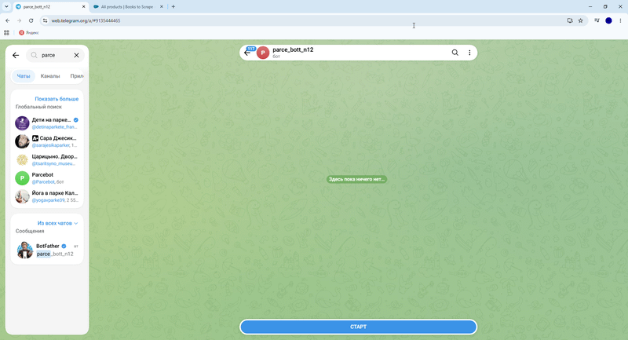

## Демонстрация работы



# 🤖 Async Parser Telegram Bot

Асинхронный Telegram-бот для мониторинга и сбора данных с веб-сайтов. Проект разработан на базе современного стека с использованием `aiogram v3` и `httpx` + `BeautifulSoup`.

## 🚀 Используемые технологии
- **Python 3.10+**
- **Aiogram v3** (асинхронный фреймворк для Telegram-ботов)
- **Httpx** (быстрый асинхронный HTTP-клиент)
- **BeautifulSoup4 & Lxml** (парсинг и разбор HTML-структуры)

## 📌 Функционал
- Команда `/start` — приветствие пользователя и инструкция по использованию.
- Команда `/parse <URL>` — асинхронный запрос к сайту, парсинг каталога товаров и вывод результатов прямо в чат.

---

## ⚙️ Установка и запуск

1. **Клонируйте репозиторий:**
   ```bash
   git clone [https://github.com/nikitasokolov2468-cmyk/parser_bot.git](https://github.com/nikitasokolov2468-cmyk/parser_bot.git)
   cd parser_bot
Создайте и активируйте виртуальное окружение:

Для Windows:

Bash
python -m venv .venv
.venv\Scripts\activate
Для macOS / Linux:

Bash
python3 -m venv .venv
source .venv/bin/activate
Установите зависимости:

Bash
pip install aiogram httpx beautifulsoup4 lxml
Запустите бота:

Bash
python bot.py
